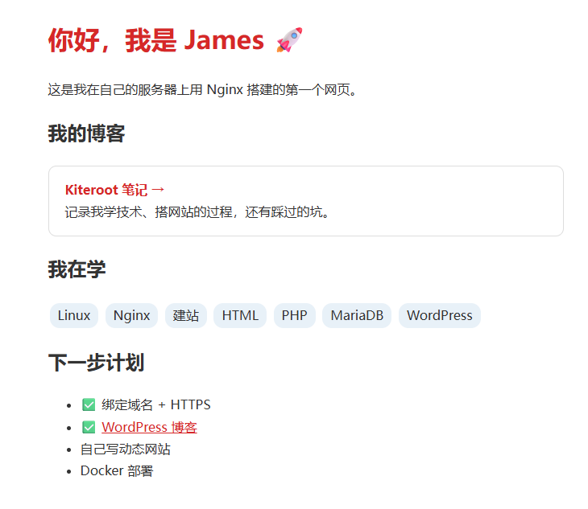
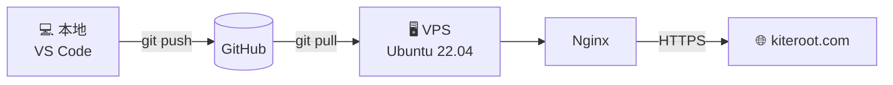

<div align="center">

# 🪁 kiteroot.com

**从零搭建在自己 VPS 上的个人主页**

*风筝飞得高，根扎得深*

[](https://kiteroot.com)
[](https://github.com/JamesLiu524/kiteroot-site/commits/main)




</div>

---

## ✨ 关于

这是我学习 Linux 和建站的练手项目。从买服务器、配置安全、安装 Nginx，到绑定域名、申请 HTTPS，每一步都是自己在命令行里完成的。

## 🏗️ 架构



## 🚀 部署

```bash
# 本地：提交并推送
git add .
git commit -m "更新说明"
git push

# 服务器：拉取最新代码
ssh kiteroot "git -C /var/www/html pull"
```

## 🔒 安全措施

| 项目 | 做法 |
|------|------|
| SSH 登录 | 只允许密钥，禁止密码和 root 登录 |
| 防暴力破解 | fail2ban 自动封禁 |
| 传输加密 | 全站 HTTPS，自动续期 |
| 敏感目录 | Nginx 禁止访问 `.git` |

## 🗺️ 学习路线

- [x] 静态个人主页
- [x] 域名 + HTTPS
- [x] WordPress 博客 → [blog.kiteroot.com](https://blog.kiteroot.com)
- [x] Git + GitHub 部署
- [ ] 自己写动态网站
- [ ] Docker 部署

<details>
<summary>📚 踩过的坑</summary>

- **把自己关在门外**：测试禁止 root 登录时失败太多次，被 fail2ban 封了自己的 IP，最后通过 VNC 控制台解封
- **证书续期失败**：acme.sh 的 standalone 模式和 Nginx 抢 80 端口，改成 webroot 模式解决
- **终端中文变方框**：不是编码问题，是终端字体没有中文字形

</details>

---

<div align="center">

Made with ❤️ by **James**

</div>